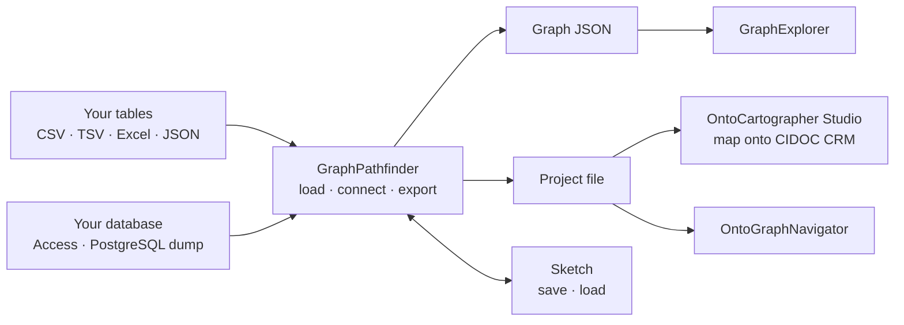

<p align="center">
  <strong>Finds the way from your tables to a graph.</strong><br>
  GraphPathfinder is a browser-based tool for turning tables into a graph as quickly as possible. Load CSV, Excel or JSON files, an Access database or a PostgreSQL dump, and every column becomes a node on a canvas. A database brings its keys and relationships along. Whatever is not declared (keys, shared values, link tables, Harris matrix relations), GraphPathfinder finds by itself and suggests. You can accept the suggestions with one click, or draw your own connections by dragging one column onto another. Look at the result right away in the GraphExplorer, or hand it as a project file to OntoCartographer Studio and the OntoGraphNavigator.<br>
  No ontology, no code, no server, and your data never leaves your computer.
</p>

<p align="center">
  
  
  
  
  
</p>

---

## What is GraphPathfinder?

[OntoCartographer Studio](https://github.com/oeai-dac/OntoCartographer-Studio) maps tables onto an ontology precisely, class by class and column by column. That is the right tool when you know your model, but a long way round when you first want to see what is in your data. GraphPathfinder is the quick way in: it reads your tables, makes every column a node and finds the connections between them. A few clicks later you see your data as a graph in the [GraphExplorer](https://github.com/oeai-dac/GraphExplorer): as lists, a network, a Harris matrix, a map or a timeline.

When you need more, the result goes on as a project file: to OntoCartographer Studio, where you can map it onto e.g. CIDOC CRM, and to the [OntoGraphNavigator](https://github.com/oeai-dac/OntoGraphNavigator) for the daily work on the data.

It was developed for archaeological data (excavations, stratigraphic units, finds, phases and their Harris matrix relations) but works with any tables. It runs in your browser, on your own computer. Nothing is uploaded anywhere.



New to knowledge graphs? The [GraphExplorer's README](https://github.com/oeai-dac/GraphExplorer#new-to-knowledge-graphs) has a short introduction.

### Why GraphPathfinder?

- **No ontology to start with**: types and connections come from your tables. Map them onto an ontology (e.g. CIDOC CRM) later in the Studio, if you need to
- **Databases bring their structure**: open an Access database or a PostgreSQL dump, and its keys and relationships are applied at once. Only what is guessed comes as a suggestion
- **One gesture**: drag a column onto a column. Onto another table, and both name the same thing. Within one table, and they become a connection
- **Suggestions**: what GraphPathfinder reads from names and values (keys, references, shared values, link tables, Harris matrix relations) is applied only when you accept it
- **Made for archaeology**: stratigraphic relations, phases, objects and unit types become a Harris matrix in the GraphExplorer and the OntoGraphNavigator
- **Reusable**: save your work as a sketch (without the data) and open it again with the same tables or a newer export of them
- **Everything stays on your machine**: it runs locally in your browser (no account, no cloud, no upload)

---

## Installation

### Prerequisites

- **Node.js 18+** (includes npm): download from <https://nodejs.org/en/download/>
- A current web browser (Firefox, Chrome, Edge, Safari, …). An internet connection is needed for the setup only; your data is never sent anywhere.

### Get the Project

Download the repository as a ZIP from GitHub (**Code → Download ZIP**) and unpack it, or clone it:

```bash
git clone https://github.com/oeai-dac/GraphPathfinder.git
cd GraphPathfinder
```

### Start

- **Windows:** double-click **`START-GraphPathfinder.bat`**
- **Mac/Linux:** open a terminal in the project folder and run `npm install` (only the first time), then `npm run dev -- --open`

On the first start, all required components are downloaded; this takes a few minutes. Afterwards your browser opens GraphPathfinder at <http://localhost:3003>.

**To stop:** on Windows, close the window titled *GraphPathfinder*. On Mac/Linux, press `Ctrl+C` in the terminal.

<details>
<summary><b>Share it without installation (standalone file)</b></summary>

```bash
npm run build:standalone     # creates GraphPathfinder-standalone.html (~1 MB)
```

Send the file (zipped, since many mail servers block `.html` attachments). The recipient double-clicks it and drops in their tables. No Node.js, no installation, no server.

</details>

### Updating and Uninstall

To update, replace the project folder with the new version (or `git pull`), delete the folder `node_modules`, and start again. To uninstall, delete the project folder. A copy of your last sketch is kept in your browser; clearing the site data for `localhost:3003` removes it.

---

## Quick User Guide

1. **Load**: drop your tables onto the page: CSV, TSV, Excel (every sheet) or JSON, several at once. Or a database: an Access file (`.accdb`, `.mdb`) or a PostgreSQL dump (`.sql`). Every table becomes a card, every column a row on it.
2. **Suggestions**: check what GraphPathfinder found and **Accept** the suggestions one by one, or **Accept all**. Click a suggestion to see its tables on the canvas.
3. **Connect**: drag a column onto a column. Onto another table: both name the same thing (e.g. `site_id` in one table and `id` in the *site* table). Within one table: an edge from one to the other (e.g. from a find to its material).
4. **Inspector**: click a column to decide how it is read: key, label, reference, own type, edge, attribute or not used. Click an edge for its name and its role in the Harris matrix. **Resulting graph** on the right shows the types and connections that come out.
5. **Explore** saves a Graph JSON: drop it into the GraphExplorer. **Project file** saves a project file for OntoCartographer Studio and the OntoGraphNavigator.
6. **Save sketch** (Ctrl+S) saves your work without the data. Load it again together with the tables to continue.

**Undo / Redo** are in the toolbar (Ctrl+Z / Ctrl+Y).

<details>
<summary><b>Details: loading a database</b></summary>

**Access** (`.accdb` from Access 2007 on, `.mdb` from Access 2000–2003): tables, primary keys, unique indexes and relationships are read. Columns that hold files (OLE objects, attachments) are left out; a message names them.

- *Split database:* if the file only links to tables in another file (a "front end"), load the "back end" that holds the data. GraphPathfinder names the linked tables.
- *Password:* password-protected `.accdb` files cannot be read yet. Remove the password in a copy (**File → Info → Decrypt Database**) and load the copy.

**PostgreSQL**: GraphPathfinder does not connect to your database server. It reads a dump in plain SQL, the format `pg_dump` writes by default:

```bash
pg_dump --no-owner --no-privileges -f excavation.sql <database>
```

Add `-h`, `-p` and `-U` for host, port and user. On Windows, `pg_dump.exe` is in `C:\Program Files\PostgreSQL\<version>\bin`. In pgAdmin: **Backup… → Format: Plain**. A backup in custom format (`pg_dump -Fc`, pgAdmin's default) is an archive, not SQL; turn it into SQL with `pg_restore -f excavation.sql <archive>`. PostGIS geometries become WKT for the GraphExplorer's map; binary columns (`bytea`) are left out.

</details>

---

## Example Data

The folder `0_exampleData/` contains the fictional excavation *Serpent's Meadow* as eleven tables. The GraphExplorer and the OntoGraphNavigator come with the same excavation.

1. [Start GraphPathfinder](#start).
2. Drop all files from `0_exampleData/serpents_meadow_tables/` onto the page, or `serpents_meadow.xlsx`, or one of the databases: `serpents_meadow.accdb`, `serpents_meadow.mdb` or `serpents_meadow.pgdump.sql`.
3. **Suggestions → Accept all**.
4. **Explore**, then drop the saved file into the GraphExplorer. Its **Harris Matrix** view shows the stratigraphic sequence.

From a database, the keys and relationships come along: only two suggestions are left, the Harris matrix and the phases. All sites, people, units, finds and dates are invented.

---

## Troubleshooting

### Installation and Start

**"node is not recognized" / Node.js was not found**
Node.js is not installed or not in your PATH. Install Node.js 18+ from <https://nodejs.org/en/download/> and start again.

**The browser does not open, or shows an error**
Look at the window opened by `START-GraphPathfinder.bat` (or your terminal): it prints the address, usually <http://localhost:3003>.

**Something behaves oddly after an update**
Delete the folder `node_modules` and start again (see [Updating and Uninstall](#updating-and-uninstall)).

### Loading

**"This is a pg_dump archive …"**
The file is a backup in custom format, not SQL. Export it as plain SQL (see *Details: loading a database* in the [Quick User Guide](#quick-user-guide)).

**"The database is password-protected"**
Remove the password in a copy of the database and load the copy.

**"… linked tables live in another file"**
You loaded the front end of a split Access database. Load the back end, the file that holds the tables.

**Umlauts look wrong in a CSV file**
GraphPathfinder recognises UTF-8 and the Windows encoding Excel uses. If the text still looks wrong, save the file from Excel as **CSV UTF-8** and load it again.

**I closed the browser without saving**
Load the same tables again: GraphPathfinder offers your last sketch back. Save it with **Save sketch** as soon as you can.

---

## For Developers

GraphPathfinder writes a Studio project file and lets the OntoGraphNavigator's own code turn it into the Graph JSON (a copy in `src/core/`, kept in step with `npm run sync-core`, with the OntoGraphNavigator in a folder next to this one). So both tools always build the same graph.

```bash
npm run check              # 8 test suites, about 470 checks, no browser needed
npm run build:standalone   # GraphPathfinder-standalone.html
npm run check:browser      # the standalone file in Chrome, used the way a person would
```

`npm run check:browser` needs Chrome (or `CHROME=<path>`) and a fresh standalone build.

---

## Roadmap

| Version | Contents |
|---|---|
| 0.1 | Tables (CSV, TSV, Excel, JSON) and databases (Access, PostgreSQL dumps) with their keys and relationships; suggestions, Harris matrix, Graph JSON and project file |
| next | SQLite and GeoPackage; a handover package with the tables for the Studio |
| later | A live connection to a database, through a small server on your own computer |

---

## License

GPL 3.0 or later — see [LICENSE](LICENSE).

---

## AI Assistance

GraphPathfinder was developed with the AI coding assistant [Claude Code](https://claude.com/claude-code) by Anthropic. Claude was used to write and refactor code, to review it against the documentation, and to help with drafting the documentation. The concept, the requirements and the testing come from the author; every change was reviewed before it was adopted.

---

## Acknowledgments and Credits

Developed for digital archaeology and cultural heritage data management, as the quick way into [OntoCartographer Studio](https://github.com/oeai-dac/OntoCartographer-Studio), the [GraphExplorer](https://github.com/oeai-dac/GraphExplorer) and the [OntoGraphNavigator](https://github.com/oeai-dac/OntoGraphNavigator).
